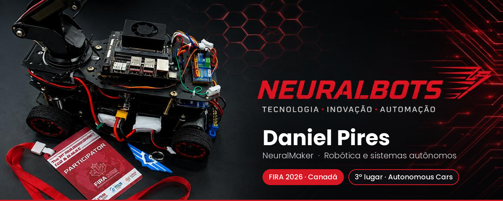
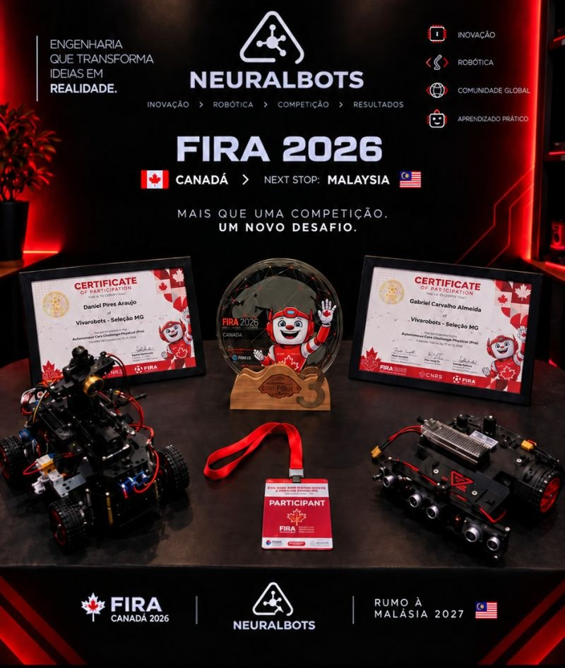
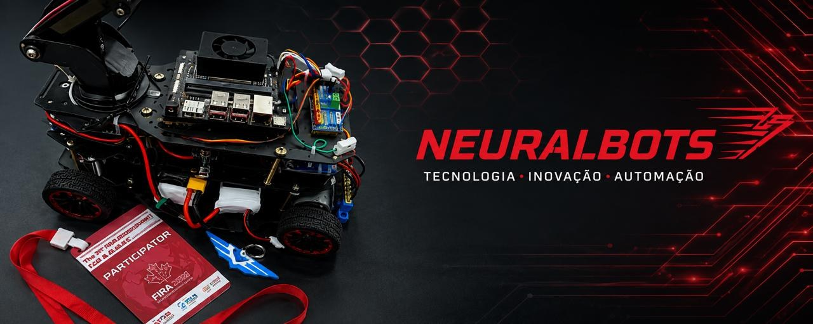
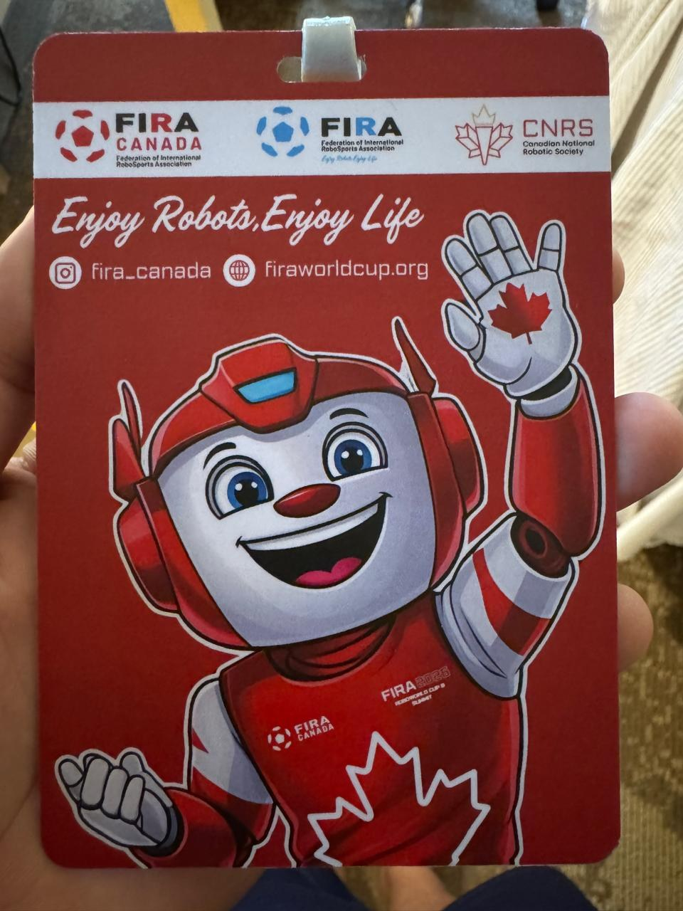
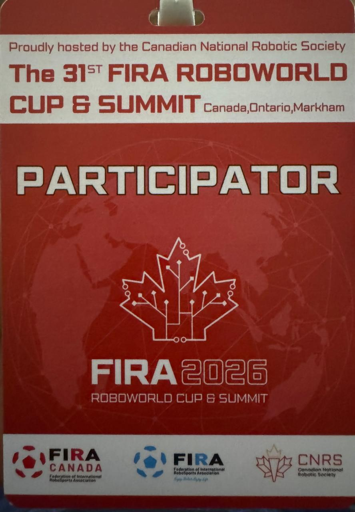

---

## 🇧🇷 Sobre mim

Sou profissional de suporte técnico de TI N1 e entusiasta de tecnologia, com foco em desenvolvimento de software, robótica e sistemas autônomos.

Gosto de entender como as coisas funcionam, resolver problemas e transformar conhecimento em projetos práticos, integrando programação, eletrônica e hardware.

Atualmente participo do desenvolvimento de soluções de robótica com a **NeuralBots**, explorando visão computacional, controle de motores, sistemas embarcados e simulação de veículos autônomos.

🎯 **Meu objetivo:** conquistar uma oportunidade de estágio ou posição júnior na área de tecnologia, contribuir com projetos reais e continuar evoluindo como desenvolvedor.

### 🔬 O que estou desenvolvendo e estudando

- 🤖 **Robótica:** veículos autônomos com a NeuralBots.
- 👁️ **Visão computacional:** processamento de imagens com OpenCV e detecção de objetos com YOLO.
- 🧠 **ROS 2:** integração de componentes e desenvolvimento de sistemas robóticos.
- 🖥️ **Sistemas embarcados:** aplicações com NVIDIA Jetson Orin Nano.
- 🌐 **Simulação:** experimentos com NVIDIA Isaac Sim e Isaac Lab.
- 🔌 **Hardware e eletrônica:** sensores, controle de motores, alimentação e integração de componentes.
- 🛠️ **Suporte de TI:** diagnóstico, troubleshooting e resolução de problemas técnicos.

🇺🇸 Read in English

 

I'm an IT Level 1 Support professional and technology enthusiast focused on software development, robotics, and autonomous systems.

I enjoy solving problems and turning ideas into practical projects by combining programming, electronics, and hardware.

I'm currently involved in robotics projects with **NeuralBots**, exploring computer vision, motor control, embedded systems, and autonomous vehicle simulation.

🎯 **My goal:** to secure a software, robotics, or embedded systems internship or junior position where I can contribute to real-world projects and keep growing as a developer.

**What I'm learning and building:** robotics and autonomous vehicles · computer vision with OpenCV and YOLO · robot software with ROS 2 · embedded computing with NVIDIA Jetson Orin Nano · simulation with NVIDIA Isaac Sim and Isaac Lab · electronics, sensors, and motor control · IT troubleshooting and technical support.

---

## 🏆 FIRA 2026 — 3º lugar em Autonomous Cars

Com a **NeuralBots**, participei da **31ª FIRA Roboworld Cup & Summit**, em Markham, Ontário (Canadá), na categoria *Autonomous Cars Challenge Physical (Pro)*. A equipe conquistou o **3º lugar** e a classificação para a etapa da **Malásia, em 2027**.

<table>
  <tr>
    <td align="center" width="50%">
       
      Carro autônomo da NeuralBots com Jetson Orin Nano
    </td>
    <td align="center" width="25%">
       
      Crachá FIRA 2026
    </td>
    <td align="center" width="25%">
       
      Participante
    </td>
  </tr>
</table>

---

## 🤖 Projeto em destaque

### 🔴 NeuralBots — Robótica e Sistemas Autônomos

Desenvolvimento de robôs autônomos que integram software, eletrônica, visão computacional e sistemas embarcados.

**Áreas de desenvolvimento:**
- Processamento de imagens e reconhecimento de pista.
- Detecção de obstáculos com visão computacional.
- Controle de direção e motores.
- Integração de sensores e hardware.
- Software robótico com ROS 2.
- Simulação e experimentação de sistemas autônomos.

🔗 [Explorar meus repositórios](https://github.com/NeuralMaker-Daniel?tab=repositories)

---

## 🧰 Tecnologias e ferramentas

**Programação e visão computacional**

**Robótica e sistemas embarcados**

**Simulação e desenvolvimento**

---

## 📊 GitHub

---

## 🤝 Vamos nos conectar? | Let's connect!

Estou aberto a oportunidades de estágio, posições júnior, colaboração em projetos e conexões com profissionais da área.

**Tecnologia • Engenharia • Inovação**

